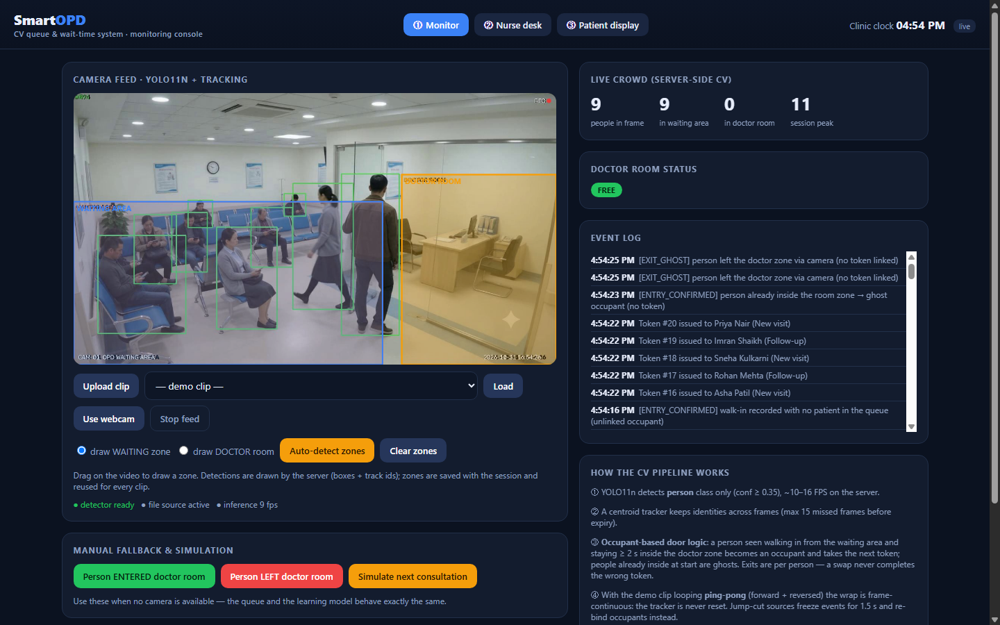
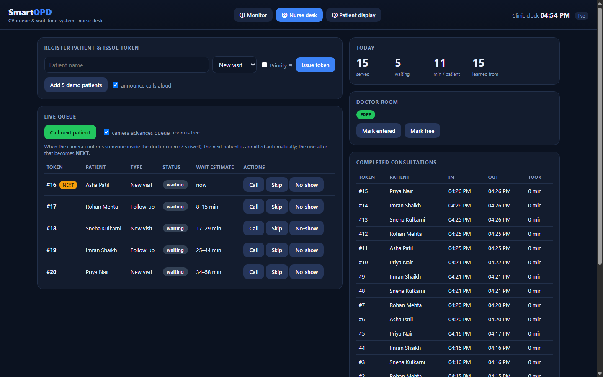
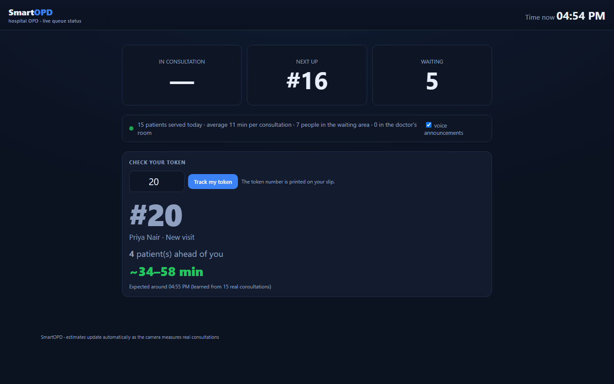

# SmartOPD — CV-based OPD Queue & Wait-Time System


A computer-vision powered outpatient-department (OPD) queue manager for a small
clinic/hospital. A camera watches the waiting area; a YOLO11n detector + tracker
measure the crowd and the doctor's room occupancy; an adaptive model learns real
consultation lengths and predicts per-token wait times.

Three interfaces, one server:

| # | Interface | URL | For whom |
|---|-----------|-----|----------|
| ① | **Monitoring console** | `http://127.0.0.1:8000/` | camera view, zone drawing, live crowd, event log |
| ② | **Nurse desk** | `http://127.0.0.1:8000/nurse` | register patients, issue tokens, call next, skip/no-show, CSV export |
| ③ | **Patient display** | `http://127.0.0.1:8000/patient` | TV/kiosk board: now serving, please proceed, waiting count, my-token ETA |

## Screenshots

**① Monitoring console — live YOLO11n tracking, zones, crowd, reason-coded event log**



**② Nurse desk — token issue, NEXT badge, wait estimates, history, undo**



**③ Patient display — kiosk board + per-token ETA lookup**



## Quick start (Windows)

1. Double-click **`run.bat`**.
   * First run: it creates a private Python environment (`.venv/`), installs the
     libraries and downloads the YOLO11n weights (~6 MB) — **all inside this
     folder**, nothing is installed globally.
   * Then it starts the server and opens the browser.
2. On the **Monitor** page: pick the bundled demo clip
   (`samples/People_in_hospital_waiting_room_74f5013d.mp4`), upload your own
   video, or click **Use webcam** (runs on the server, works with any browser).
3. Click **Auto-detect zones** or drag two rectangles: *WAITING* area and
   *DOCTOR room/door*.
4. On the **Nurse desk**: register patients and press **Call next patient**.
5. Open the **Patient display** full-screen on any second screen.

Requirements: Python 3.11 (via the `py` launcher) and internet access on first
run only. Stop the server with `Ctrl+C` in the console window.

## What changed vs the prototype (v1)

The original single-file HTML app ran COCO-SSD **in the browser from a CDN**, so
it broke offline (the "Detector failed to load (needs internet)" error) and
state was trapped per-browser in `localStorage`.

| | v1 (prototype) | current version |
|---|---|---|
| Detection | COCO-SSD via CDN, in-browser | **YOLO11n on the server**, weights stored locally |
| Tracking | naive nearest match, flicker-sensitive | centroid tracker + **latched** zone state machine (3–4 frame debounce) |
| State | one browser's `localStorage` | server-side JSON (`data/state.json`), shared by all 3 screens |
| Wait-time model | 8-min prior + last-10 median | same idea, formalised + **unit-tested** (prior → rolling median ramp) |
| Interfaces | 3 tabs in one page | 3 separate pages/URLs for 3 different machines/screens |
| Video | browser `<video>` only | server-side file/webcam, annotated snapshot stream to any client |
| Ops | — | one-click `run.bat`, tests, CSV export, event log, API docs |

## Architecture

```
                ┌────────────────────────── server (app/) ──────────────────────────┐
 camera/file ──▶│ VisionWorker (thread)                                                │
                │   cv2 capture ─▶ YOLO11n persons ─▶ CentroidTracker ─▶ ZoneAnalyzer │
                │        │                                              │ enter/free    │
                │        │ annotated JPEG ◀─ draw zones/boxes/ids      ▼              │
                │        │                                     QueueEngine              │
                │        ▼                                     tokens · room · ETA       │
                │   /api/snapshot.jpg                        │  ▲                      │
                └────────┼────────────────────────────────────┼──┼──────────────────────┘
                         │  poll /api/state (1 s)             │  │
        ┌────────────────┴────────────────────────────────────┼──┼───────────┐
        │                │                     │              │  │           │
   ① Monitor      ② Nurse desk          ③ Patient display    │  │           │
   zone drawing   register / call       board + my-token ETA  │  │           │
                                                        manual enter/free ────┘
```

* **Detection** — `app/vision.py` `PersonDetector`: YOLO11n, person class only,
  conf ≥ 0.35, ~10 FPS, CPU or GPU automatically.
* **Tracking** — `CentroidTracker`: greedy nearest-neighbour matching with a
  15-frame miss budget; a vanished occupant track counts as a door exit.
* **Zones / room logic** — `ZoneAnalyzer`: occupant-based and direction-aware.
  An ENTRY needs an outside sighting plus ENTRY_DWELL (2 s) of continuous
  presence; people already inside at start are GHOSTS (no token); exits are
  per occupant (a swap never completes the wrong token); a jump-cut loop
  holds events for SEAM_HOLD (1.5 s) then re-binds occupants, while the
  ping-pong demo source loops continuously with no reset at all.
* **Queue** — `app/queue_manager.py`: token lifecycle
  `waiting → called → in → done` (+ skipped/no-show), priority ordering,
  occupant-linked camera admissions (never backwards), manual/simulated
  overrides, adaptive wait-time model.
* **Wait-time model** — starts from an 8-minute prior, ramps to the rolling
  median of the last 12 *measured* consultations (full trust after 4); patient
  ETA = remainder of current consultation + (people ahead × average), shown as
  a range (−25 %/+30 %). Durations enter the model multiplied by TIME_SCALE
  (60 for clips, 1 for webcam) so short demo videos produce realistic minutes.
* **Persistence** — `app/store.py`: atomic JSON writes to `data/state.json`
  every 2 s; corrupt files self-heal instead of crashing.

## Project layout

```
run.bat                  one-click launcher (creates .venv, starts server)
requirements.txt         local dependencies (installed into .venv/)
requirements.lock.txt    exact frozen versions (created on first setup)
scripts/ensure_ready.py  first-run environment checks
app/
  config.py              all paths pinned INSIDE the workspace
  server.py              FastAPI app: pages + JSON API
  queue_manager.py       queue engine + adaptive wait-time model
  vision.py              detector wrapper, tracker, zone state machine
  worker.py              video/webcam capture thread, annotation, auto-zones
  store.py               atomic JSON persistence
  pages/                 monitor.html · nurse.html · patient.html
  static/                shared css/js (polling, zone canvas, announcements)
models/yolo11n.pt        YOLO11n weights (downloaded on first run)
samples/                 bundled demo clip (hospital waiting room)
data/state.json          runtime state (tokens, room, learned durations, zones)
tests/                   unit tests (queue engine + vision logic)
```

## API (summary — full docs at `/api/docs`)

| Method & path | Purpose |
|---|---|
| `GET /api/state` | full state: tokens, ETA per token, room, crowd, events, zones, vision status |
| `POST /api/tokens` `{name, kind, priority}` | register patient, issue token |
| `POST /api/tokens/seed` | add 5 demo patients |
| `POST /api/queue/call-next` | call the next patient |
| `POST /api/tokens/{no}/action` `{action: call\|skip\|noshow\|requeue}` | queue actions |
| `POST /api/room/enter?src=…` / `POST /api/room/free?src=…` | manual room events |
| `POST /api/simulate` | finish one consultation instantly (demo without camera) |
| `POST /api/reset` | clear tokens/history/learned times |
| `GET /api/export.csv` | today's history as CSV |
| `GET /api/snapshot.jpg` | latest annotated frame |
| `POST /api/upload` (multipart) | upload a clip (stored in `data/uploads/`) |
| `POST /api/source` `{kind: file\|webcam, value}` | select the video source |
| `POST /api/zones` `{wait, doc}` | save normalized zone rectangles |
| `POST /api/zones/auto` `{source}` | auto-detect zones from the clip |

## Running the tests

```
.venv\Scripts\python.exe -m pytest tests -q
```

`tests/test_queue.py` covers the token lifecycle, priority order, room
occupancy, the learning behaviour of the wait-time model, serialization
round-trips and CSV export. `tests/test_vision.py` covers tracker identity,
expiry, and the zone-latch state machine (incl. flicker rejection).

## Troubleshooting

* **"Setup failed"** — make sure Python 3.11 is installed and `py -3.11`
  works; the launcher refuses to install anything globally.
* **Webcam button errors** — the webcam is opened *by the server*; it must run
  on the machine the camera is plugged into. If another app holds the camera,
  close it first.
* **No people detected** — lower light/angle issues; try redrawing the zones
  and check the conf threshold in `app/config.py` (`DEFAULT_CONF`).
* **Reset demo data** — Nurse desk → *Reset everything*, or delete
  `data/state.json` while the server is stopped.

## Privacy

Frames are processed in memory and never stored or uploaded anywhere; only
anonymous counters, tokens and consultation durations are written to
`data/state.json` inside this folder. Patient names exist only because the
nurse types them locally — do not use real patient identifiers in demos if the
machine is shared.
